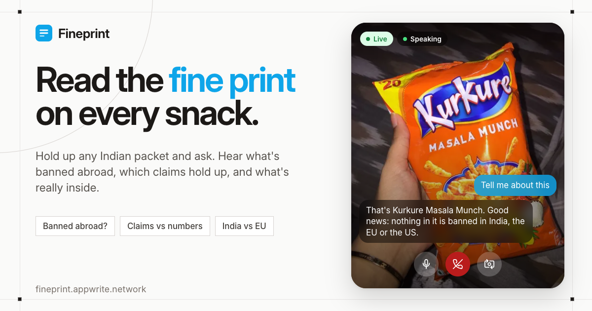

# Fineprint

**Read the fine print on every snack.**



Fineprint checks Indian packaged food. Hold a pack up to your camera and ask out loud; it tells you which additives are banned or restricted in India, the EU or the US, whether the pack's marketing claims (like "sugar free" or "zero calorie") hold up against the legal limits, and how the Indian recipe differs from the European one.

**[Open the app](https://fineprint.appwrite.network)** · **[Try live voice mode](https://fineprint.appwrite.network/live)**

Built for the Appwrite Databases Hackathon and the Bolna voice AI buildathon, October 2026.

## What it does

- Live voice mode: a video-call style page. The call connects when you open it; you point the camera at a pack and ask "what's in this?". The frame freezes and pins in the chat while it looks the pack up. Answers are spoken and captioned word for word over the video (your words as the speech-to-text heard them, and the agent's reply as it is spoken). Mute, end call, switch camera and mute-answers buttons sit on the video.
- Answers written for the ear: "That's Diet Coke. Good news: the zero-calorie claim checks out and nothing in it is banned in India, the EU or the US. It's sweetened with aspartame. Want to hear how it differs from the UK version?" Follow-up questions are answered only from checked facts.
- General label questions ("is aspartame safe?", "what is INS 621?", "what does sugar free mean?") are answered from regulators and public-health bodies only (FSSAI, EFSA, European Commission, US FDA, WHO, FAO, NHS, UK FSA), naming the source; the model must quote a sentence that is verified to be on the source page, otherwise it says it couldn't find a reliable answer.
- Scan: barcode, front-of-pack photo, or back-label photo. Unknown products are researched in the background by an agent (catalog vector search, then web search); web ingredient lists are only accepted when quoted word for word from a page naming the exact variant.
- Checks: claims vs EU Regulation 1924/2006 thresholds; additives vs India/EU/US status, each status backed by a quote verified on the regulator's page; sugar in teaspoons and salt vs the WHO daily limit; India vs EU/UK ingredient comparison.
- Catalog: every scanned product is saved and shared; shoppers can add or challenge an ingredient list with a photo of the back label.

## How it uses Appwrite

- TablesDB tables: `products` (product payload plus vector columns `embedding` and `image_embedding` for name and pack-photo search, loaded into memory and searched there), `counterparts` (cached EU/US versions per product), `substances` (additive status per region with source quotes, grown automatically when a scan finds a new additive), `submissions` (shopper photos that add or challenge ingredient lists), `scan_logs` (one row per scan: outcome, timing, LLM usage).
- Storage bucket `pack-images`: pack photos, served as resized thumbnails.
- Sites: the React web app is hosted on Appwrite Sites (fineprint.appwrite.network).
- Leave APPWRITE_PROJECT_ID empty to run with an in-memory store locally.

## How it uses Bolna

- A Bolna voice agent, reached from the browser with the Bolna Web Call SDK; the backend mints call sessions so the API key stays server-side. The page passes a live session id; the browser streams one camera frame per second to the backend.
- Tools (Bolna API tools): `lookup_visible_product` (looks up the latest camera frame), `wait_for_lookup` (a wait loop so the agent announces a background lookup's result without being asked), `lookup_food_label` (by product name), `ask_label_question` (general label questions from trusted sources).
- Custom LLM: the agent's LLM is our OpenAI-compatible endpoint `/llm/v1/chat/completions`, which streams DeepSeek Flash (thinking off, falling back to Gemini Flash Lite) and records each turn, which is how the page shows exact captions of both sides.
- Speech-to-text: Sarvam saaras:v4 (built for Indian English and Hinglish) with brand-name keywords; the agent config lives in `bolna/label-check-agent.json` and is pushed with `bolna/push.py`.

## Architecture

Browser (React + Vite, Appwrite Sites) sends scans and live frames to a FastAPI backend on a small VM behind a Cloudflare Tunnel (`food-label-api.tinkerers.space`). The backend reads and writes Appwrite TablesDB + Storage, and the Bolna agent calls back into backend tool endpoints and `/llm/v1` for answers.

- Browser (React + Vite, Appwrite Sites) -> FastAPI backend behind Cloudflare Tunnel
- FastAPI backend -> Appwrite TablesDB + Storage
- Bolna agent -> backend tool endpoints and `/llm/v1/chat/completions`
- Backend -> Open Food Facts, Exa web search, DeepSeek/Gemini via LiteLLM
- EmbeddingGemma 2 embeddings (text and image) run in-process

## Repo layout

- `backend/` FastAPI app (`app/main.py` endpoints, `agent.py` research agent, `verdict.py` and `rules/` checks, `voice.py` spoken answers, `voice_llm.py` LLM proxy and captions, `ask.py` label questions, `store.py` Appwrite store)
- `web/` React app (`src/pages/Live.tsx` live mode)
- `bolna/` agent config and scripts
- `deploy/` VM deploy script, systemd unit, Cloudflare Tunnel config
- `web/og/` link-preview image and video source

## Run it locally

Backend (Python 3.12, uv):

```
cd backend
cp .env.example .env   # add your keys; leave APPWRITE_PROJECT_ID empty for an in-memory store
uv sync
uv run uvicorn app.main:app --reload
uv run pytest
```

The embedding model is downloaded from Hugging Face on first start and needs about 3.3 GB RAM; if Hugging Face asks for access, accept the model's licence there and set `HF_TOKEN`. Set `EMBEDDINGS_ENABLED=false` for a quick start without it (image and name search are then off).

Web:

```
cd web
npm install
VITE_API_URL=http://localhost:8000 npm run dev
```

Keys used (all optional except an LLM key): DEEPSEEK_API_KEY or GEMINI_API_KEY, EXA_API_KEY (web research and label questions), APPWRITE_* (database and storage), BOLNA_API_KEY (voice calls), LLM_PROXY_KEY (secret Bolna uses to call the custom LLM endpoint).

## API

| Method and path | Description |
| --- | --- |
| GET /products | List saved products from the shared catalog |
| GET /products/{key} | Get one product with its checks and verdict |
| GET /products/{key}/image | Get the stored pack photo for a product |
| GET /products/{key}/counterpart?region=EU | Compare with the EU or US version (looked up on the web if not cached) |
| POST /identify | Start a background research job for an unknown pack, returns 202, poll GET /jobs/{job_id} |
| GET /jobs/{job_id} | Poll the status and result of an identify job |
| POST /labels/extract | Read ingredients, nutrition and claims from a back-label photo |
| POST /products/confirm | Save a reviewed product to the catalog |
| POST /products/{key}/submissions | Add or challenge an ingredient list with a back-label photo |
| POST /live/frame | Send one live camera frame for the current session |
| POST /live/session | Mint a Bolna web-call session (the Bolna API key stays on the server) |
| GET /live/captions | Read exact captions for both sides of the live call |
| GET /live/result | Read the current lookup result for the live session |
| POST /voice/live-lookup | Look up the product visible in the latest live frame |
| POST /voice/live-wait | Wait for a background live lookup to finish |
| POST /voice/lookup | Look up a product by name for the voice agent |
| POST /voice/ask | Answer a general label question from trusted sources |
| POST /llm/v1/chat/completions | Custom LLM endpoint used by the Bolna agent, also records captions |

## Data sources

- [Open Food Facts](https://world.openfoodfacts.org/) product data, under the [Open Database License (ODbL)](https://opendatacommons.org/licenses/odbl/1-0/)
- Claim thresholds from EU Regulation (EC) No 1924/2006
- Additive statuses from FSSAI, EUR-Lex/EFSA and FDA pages, each with the quoted source stored

## Disclaimer

Informational only, not medical or legal advice. Not affiliated with FSSAI or any brand. A flag describes a regulatory difference between countries; it does not mean a product is unsafe. Web-sourced ingredients are quoted from the cited page, not read from your pack.

## License

MIT, see [LICENSE](LICENSE). Product data from Open Food Facts stays under the ODbL.
